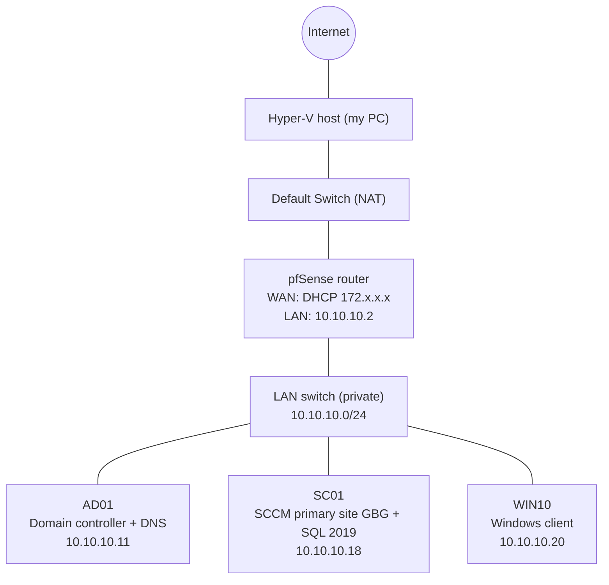

# SCCM (MECM) Home Lab on Hyper-V

A complete Microsoft Endpoint Configuration Manager lab built from scratch on Hyper-V: a pfSense router, an Active Directory domain, an SCCM primary site with SQL Server, and a Windows client that installs apps from Software Center.

Every step is documented with screenshots, from the network to an app installed from Software Center.


## What this lab shows

| Area | Skills |
|---|---|
| Virtualization | Hyper-V VMs, external and private virtual switches, memory planning |
| Networking | pfSense router/firewall, NAT, static IP plan, DNS forwarding, routing |
| Active Directory | Domain controller, DNS, domain join, System Management container and permissions |
| SCCM infrastructure | Schema extension, ADK + WinPE, SQL Server 2019, primary site install |
| SCCM configuration | Boundaries, boundary groups, AD System Discovery, collections |
| Client management | SCCM client install, client actions, Software Center |
| Application deployment | MSI and EXE apps, silent installs, detection methods, distribution, deployment |
| Monitoring | CMTrace and SCCM logs (`adsysdis.log`, `ccm.log`, `AppEnforce.log`) |

## Lab architecture



| Machine | Role | OS | IP | DNS |
|---|---|---|---|---|
| pfSense-router | Router, firewall, NAT | pfSense 2.5.2 | WAN: DHCP, LAN: 10.10.10.2/24 | – |
| AD01 | Domain controller, DNS | Windows Server 2022 | 10.10.10.11 | 127.0.0.1 |
| SC01 | SCCM primary site (GBG), SQL Server 2019, distribution point | Windows Server 2022 | 10.10.10.18 | 10.10.10.11 |
| WIN10 | Managed client | Windows client | 10.10.10.20 | 10.10.10.11 |

- **Domain:** `corp.lab`
- **SCCM site:** `GBG` – Gothenburg, Configuration Manager 2103 (build 9049), evaluation
- **Gateway for all lab machines:** `10.10.10.2` (pfSense)

## Manual

Follow the guides in order:

1. [Hyper-V and virtual switches](docs/01-hyper-v-network.md)
2. [pfSense router](docs/02-pfsense-router.md)
3. [Active Directory and DNS](docs/03-active-directory.md)
4. [Prepare SC01 and join the domain](docs/04-sc01-prepare.md)
5. [Extend the AD schema and create the System Management container](docs/05-schema-and-container.md)
6. [Prerequisites and SCCM installation](docs/06-sccm-install.md)
7. [Boundaries, boundary groups and discovery](docs/07-boundaries-discovery.md)
8. [Client setup and client install](docs/08-client.md)
9. [Application deployment (Notepad++ EXE, 7-Zip MSI)](docs/09-app-deployment.md)

Also:

- [Next steps](docs/next-steps.md) – what I plan to add to the lab
- [Scripts](scripts/) – PowerShell and SQL used in the lab

## Repository layout

```
sccm-hyperv-lab/
├── README.md
├── docs/          Step-by-step manual
├── images/        Screenshots, one folder per machine, numbered in order
│   ├── hyper-v/
│   ├── pfsense/
│   ├── ad01/
│   ├── sc01/
│   │   ├── 01-server-setup/
│   │   ├── 02-boundaries/
│   │   ├── 03-discovery/
│   │   ├── 04-install-client-win10/
│   │   ├── 05-create-app-notepad/
│   │   ├── 06-distribute-notepad/
│   │   ├── 07-collection-lab-clients/
│   │   ├── 08-deploy-notepad/
│   │   └── 09-deploy-7zip/
│   └── win10/
└── scripts/       PowerShell and SQL helpers
```

## Notes

- This is a lab, not a production design. Passwords, single-server roles and evaluation licenses are lab shortcuts.
- The lab runs Configuration Manager 2103, which is past Microsoft's end of support. A production site would be upgraded through Updates and Servicing.
- Screenshots come from a Swedish-language Hyper-V host, so some Hyper-V menus are in Swedish. The manual gives both names where it helps (for example *Virtuell växel* = Virtual switch).

## Author

Samir Mohamed – IT support / IT operations, Gothenburg, Sweden
