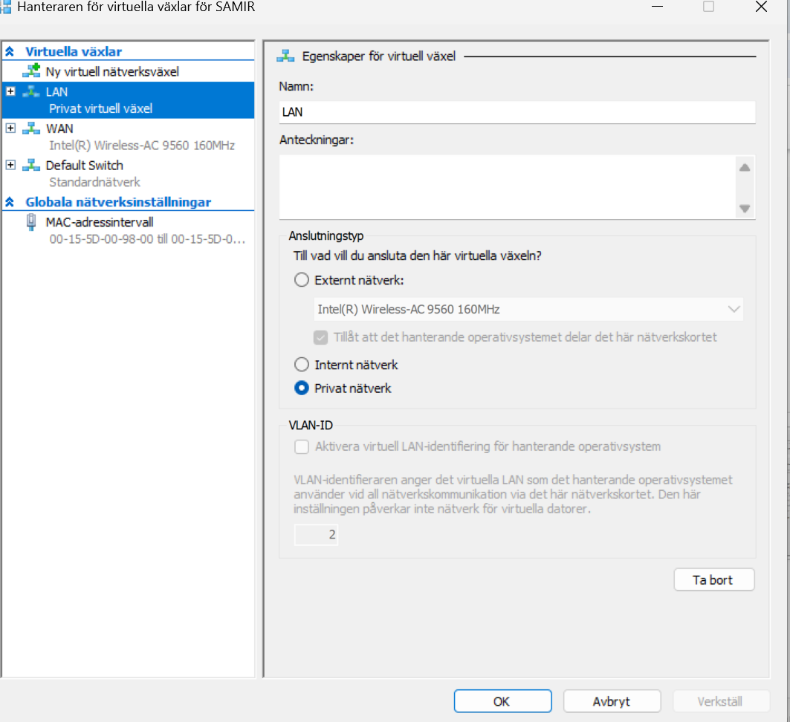
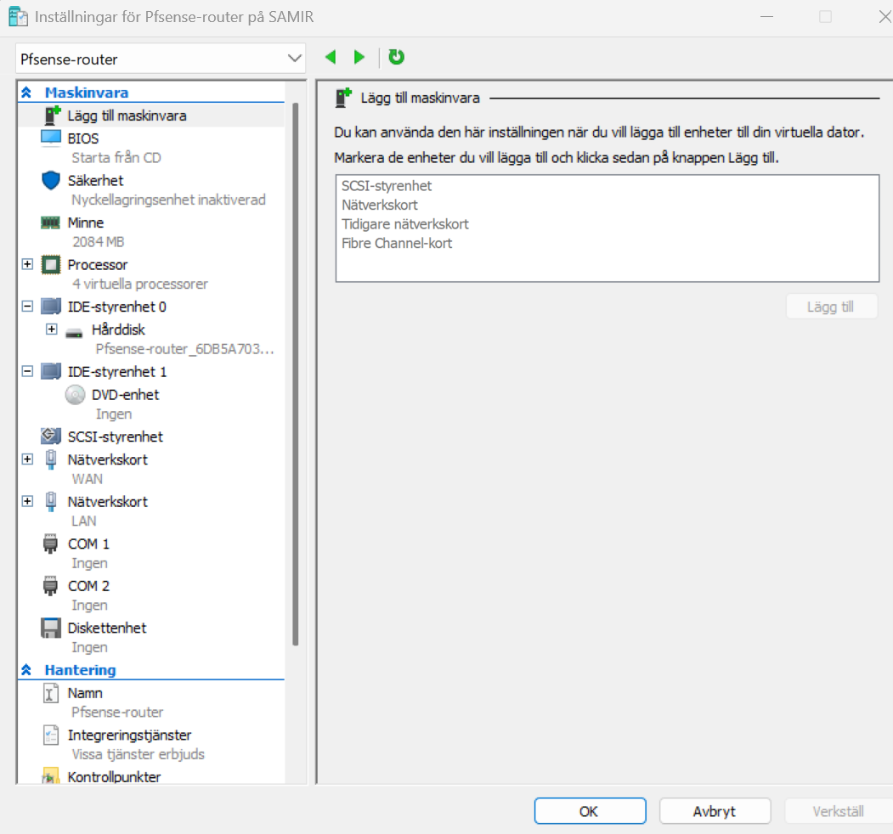
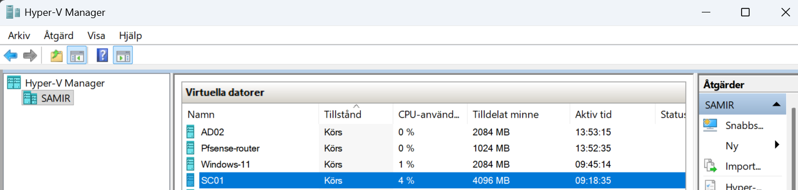

# 1. Hyper-V and virtual switches

The lab uses two networks: an outside network that gives pfSense internet access, and a private LAN where all lab machines live behind pfSense.

## Virtual switches

Open **Hyper-V Manager → Virtual Switch Manager** (*Hanteraren för virtuella växlar*).

| Switch | Type | Used by |
|---|---|---|
| **Default Switch** | Built-in NAT switch | pfSense WAN |
| **LAN** | Private (*Privat nätverk*) | pfSense LAN, AD01, SC01, WIN10 |



Create the LAN switch: **New virtual network switch → Private → Name: `LAN` → OK**.

> **Why the Default Switch?** It gives pfSense WAN internet through the host with DHCP, and it works with a Wi-Fi host. External switches bound to Wi-Fi adapters are often unreliable in Hyper-V.

## Which switch each VM uses

| VM | Network adapter 1 | Network adapter 2 |
|---|---|---|
| pfSense-router | Default Switch (WAN) | LAN |
| AD01 | LAN | – |
| SC01 | LAN | – |
| WIN10 | LAN | – |

Set it per VM: **VM → Settings (*Inställningar*) → Network Adapter (*Nätverkskort*) → Virtual switch (*Virtuell växel*)**.



## Memory plan

All VMs share the host's RAM, so plan memory before starting them all:

| VM | Startup RAM | Dynamic memory |
|---|---|---|
| pfSense-router | 1024 MB | Off (FreeBSD doesn't handle it well) |
| AD01 | 2048 MB | On, 1024–2048 MB |
| SC01 (SCCM + SQL) | 4096 MB | On, 2048–6144 MB |
| WIN10 | 2048 MB | On, 1024–3072 MB |



The Hyper-V VM names don't have to match the computer names inside them. In this lab the VM **AD02** runs the domain controller **AD01**, and the VM **Windows-11** runs the client **WIN10**.

**Start order:** pfSense → AD01 → SC01 → WIN10. The network and DNS must be up before the servers that depend on them.

## Optional: your own NAT switch

The Default Switch gets a new IP range after host reboots. To have a fixed range with your own name, run this on the host as administrator (see [scripts/host-create-nat-switch.ps1](../scripts/host-create-nat-switch.ps1)):

```powershell
New-VMSwitch -Name "NAT-WAN" -SwitchType Internal
New-NetIPAddress -InterfaceAlias "vEthernet (NAT-WAN)" -IPAddress 192.168.100.1 -PrefixLength 24
New-NetNat -Name "NAT-WAN" -InternalIPInterfaceAddressPrefix 192.168.100.0/24
```

Then give pfSense WAN a static IP `192.168.100.2/24` with gateway `192.168.100.1`.

---
Next: [2. pfSense router](02-pfsense-router.md)
