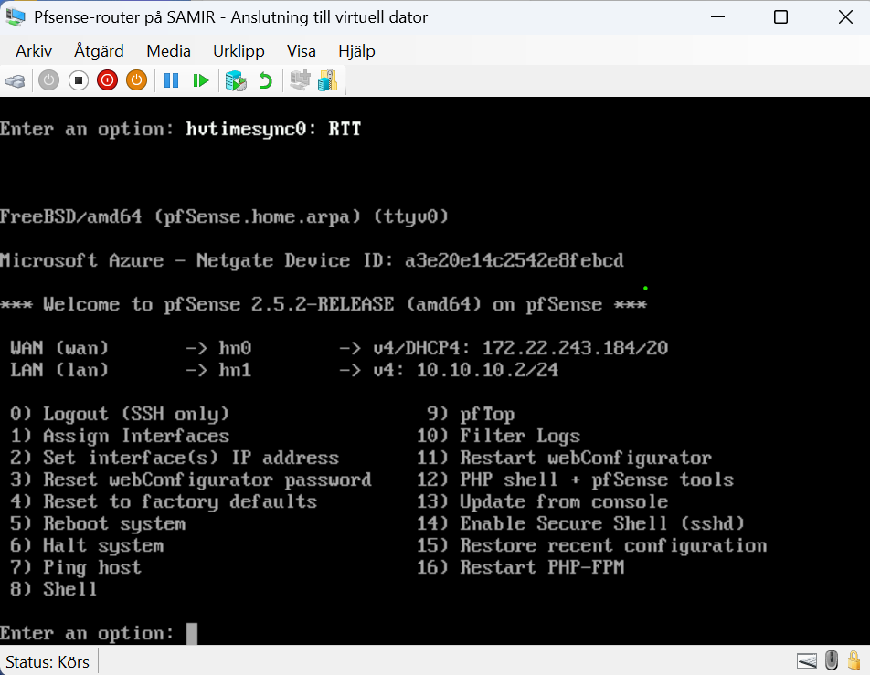
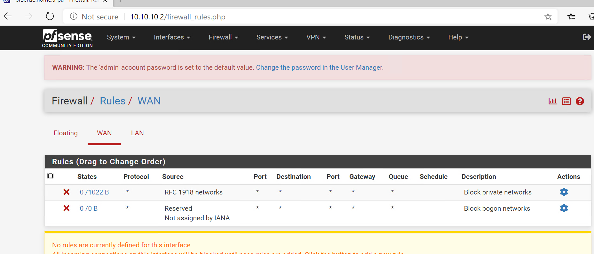

# 2. pfSense router

pfSense is the lab's router. It gives the private LAN internet access through NAT, just like a home router.

```
SC01 (10.10.10.18) → gateway 10.10.10.2 (pfSense LAN)
  → pfSense NATs the traffic out of WAN (172.x.x.x)
  → Default Switch → host → internet
```

## Interfaces

| Interface | pfSense NIC | Hyper-V switch | Address |
|---|---|---|---|
| WAN | hn0 | Default Switch | DHCP (172.x.x.x) |
| LAN | hn1 | LAN | 10.10.10.2/24 |

## Set WAN to DHCP

In the pfSense console:

1. Choose **2) Set interface(s) IP address**, then **1** (WAN).
2. Answer **y** to *Configure IPv4 address WAN interface via DHCP?*
3. Answer **n** to IPv6 and **n** to *revert to HTTP*.

The console should then show something like `WAN (wan) -> hn0 -> v4/DHCP4: 172.20.152.237/20`.



## Set LAN

Choose **2**, then **2** (LAN), and set `10.10.10.2` with subnet bits `24`. You can leave the DHCP server off, because the lab machines use static IPs.

## Check the gateway and test

Open the web interface from a LAN machine at `https://10.10.10.2` (default user `admin`, password `pfsense`, which you should change).

1. **System → Routing → Gateways:** delete any old static gateway and set **Default gateway IPv4 = WAN_DHCP**. Click **Save → Apply Changes**.
2. **Interfaces → WAN:** IPv4 Configuration Type = **DHCP**. Untick **Block private networks** and **Block bogon networks**, because the Default Switch network 172.x.x.x is itself a private range.
3. **Firewall → Rules → LAN:** the rule **Default allow LAN to any** must exist.
4. **Firewall → NAT → Outbound:** mode **Automatic**.

Test from the console with **7) Ping host → 8.8.8.8**, then from a lab machine with `ping 8.8.8.8`.



The WAN rules in the screenshot are normal. They block **incoming** traffic from the internet. They don't stop the LAN from going out.

---
Next: [3. Active Directory and DNS](03-active-directory.md)
