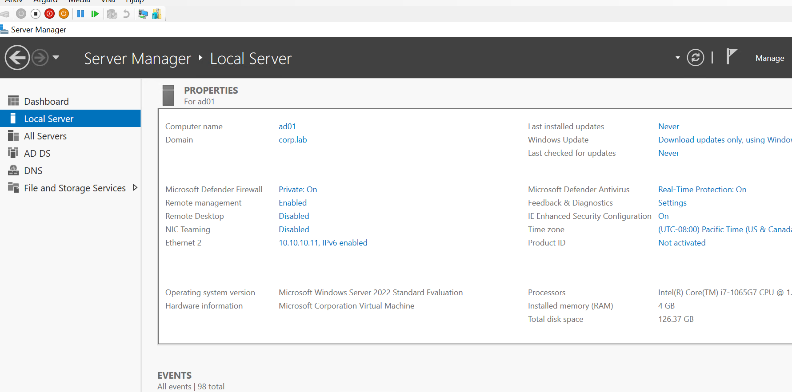

# 3. Active Directory and DNS (AD01)

AD01 is the domain controller and DNS server for `corp.lab`.

## Network settings

| Setting | Value |
|---|---|
| Hyper-V switch | LAN |
| IP address | 10.10.10.11 |
| Subnet mask | 255.255.255.0 |
| Default gateway | 10.10.10.2 |
| Preferred DNS | **127.0.0.1** (itself) |

A domain controller must use **itself** for DNS, never 8.8.8.8. Otherwise AD can't register or find its own records.

## Install AD DS and create the domain

1. **Server Manager → Add Roles and Features → Active Directory Domain Services**.
2. **Promote this server to a domain controller → Add a new forest → Root domain name: `corp.lab`**.
3. Keep DNS selected and finish. The server restarts.

### Choosing a domain name

- Lab names is `corp.lab` for this practice lab.


## DNS forwarder for internet names

AD01 answers for `corp.lab` itself. For everything else, it forwards to a public DNS:

**DNS Manager → right-click AD01 → Properties → Forwarders → Edit → `8.8.8.8`**

Now clients that use AD01 for DNS can resolve both `corp.lab` and `google.com`.



> **Tip:** if Server Manager shows the firewall profile as **Private** instead of **Domain**, the DC usually isn't using itself for DNS. Fix DNS, then run `Restart-Service NlaSvc -Force`.

## Set the time zone

The VMs came with Pacific Time, which made SCCM log timestamps confusing. Set all VMs to Swedish time:

```powershell
Set-TimeZone -Id "W. Europe Standard Time"
```

---
Next: [4. Prepare SC01](04-sc01-prepare.md)
