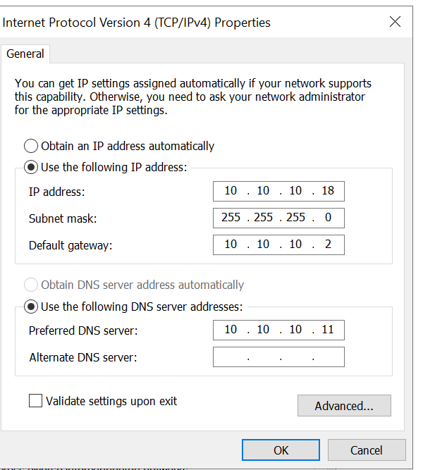
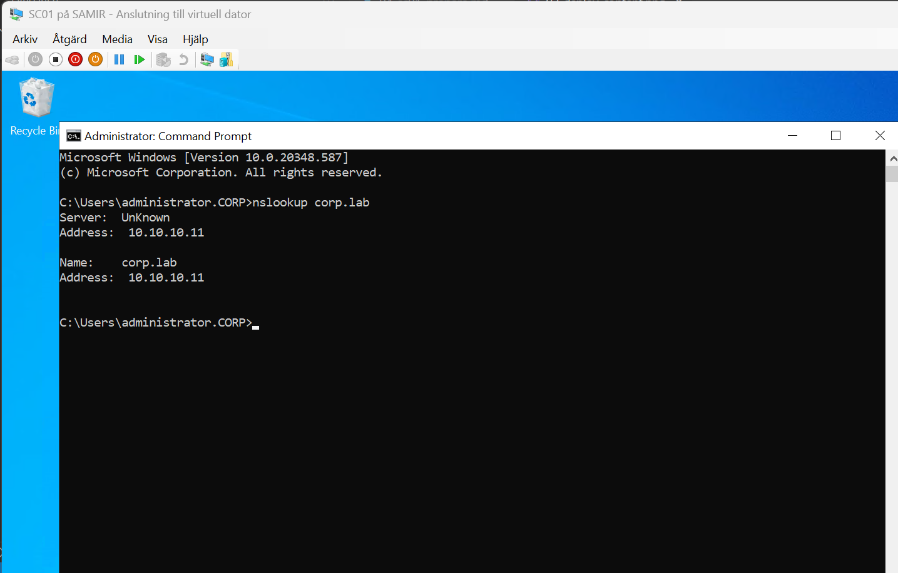
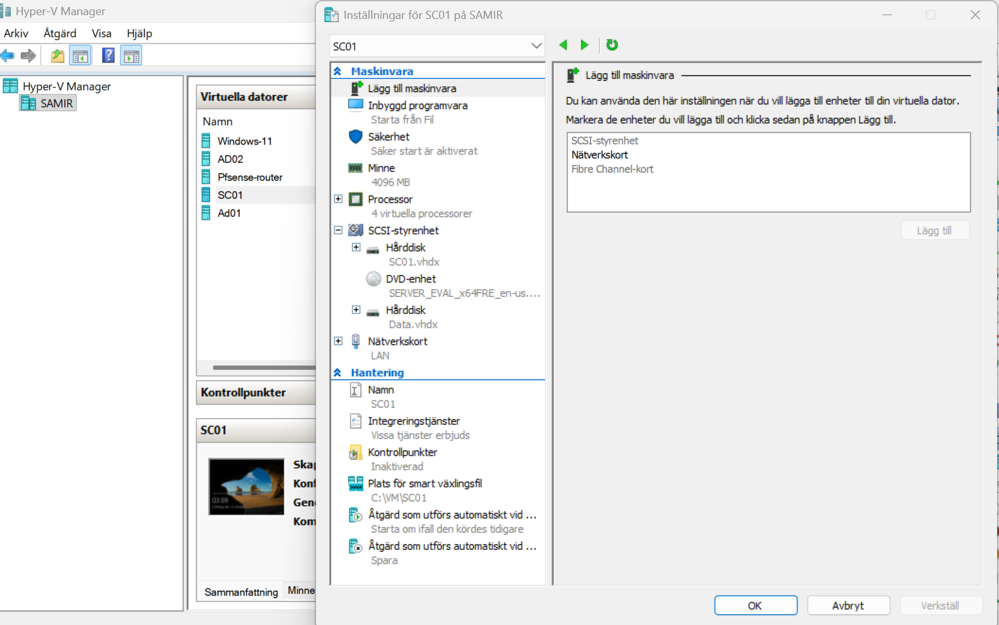

# 4. Prepare SC01 and join the domain

SC01 is the SCCM primary site server. It also runs SQL Server and the distribution point.

## Network settings

| Setting | Value |
|---|---|
| Hyper-V switch | LAN |
| IP address | 10.10.10.18 |
| Subnet mask | 255.255.255.0 |
| Default gateway | 10.10.10.2 |
| Preferred DNS | **10.10.10.11** (AD01) |
| Alternate DNS | empty |



With PowerShell:

```powershell
New-NetIPAddress -InterfaceAlias "Ethernet" -IPAddress 10.10.10.18 -PrefixLength 24 -DefaultGateway 10.10.10.2
Set-DnsClientServerAddress -InterfaceAlias "Ethernet" -ServerAddresses 10.10.10.11
```

Don't add 8.8.8.8 as alternate DNS. Windows may use it, and then it can't find `corp.lab`.

## Test before joining

```
ping 10.10.10.2                                      # pfSense
ping 10.10.10.11                                     # AD01
ping 8.8.8.8                                         # internet
nslookup corp.lab                                    # should return 10.10.10.11
nslookup -type=SRV _ldap._tcp.dc._msdcs.corp.lab     # should list ad01.corp.lab
```



## Join the domain

```powershell
Add-Computer -DomainName corp.lab -Credential CORP\Administrator -Restart
```

## Extra disks (optional)

SC01 has an extra data disk (**Data.vhdx**) next to the system disk. The SCCM, SQL and ADK installers are kept on the data volume **E:** (named *Raid5*).



Disk Management volume types, for reference:

| Volume type | Disks needed | With 2 × 20 GB |
|---|---|---|
| Spanned | 1+ | 40 GB, no protection |
| Striped (RAID-0) | 2+ | 40 GB, fast, no protection |
| Mirrored (RAID-1) | 2 | 20 GB, protected |
| RAID-5 | 3+ | needs a third disk |

---
Next: [5. Schema extension and System Management container](05-schema-and-container.md)
