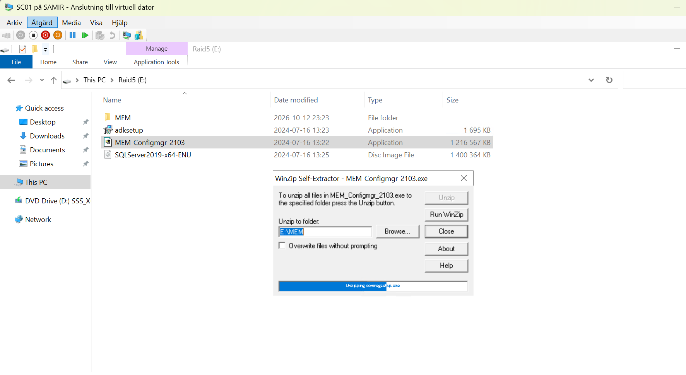
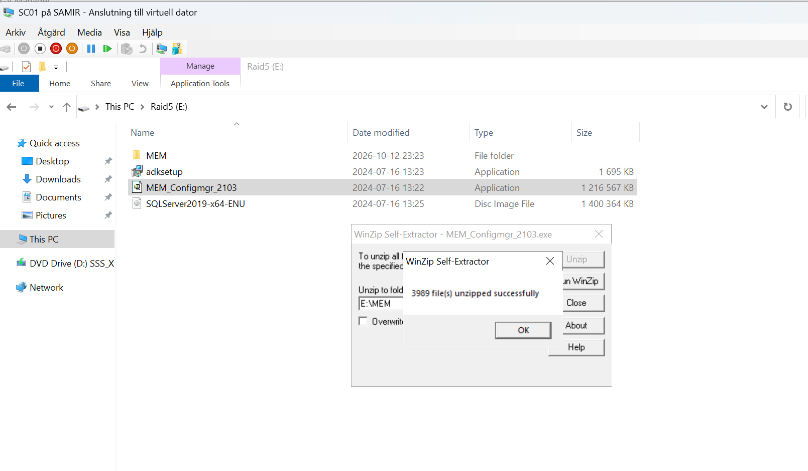
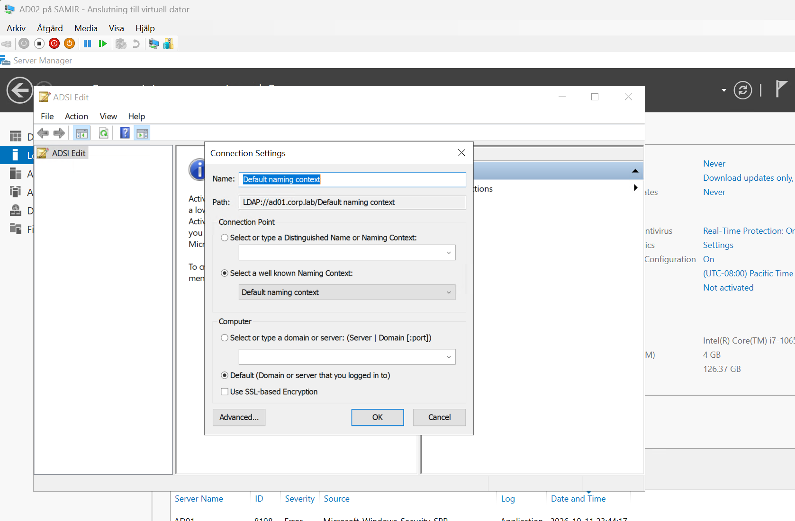
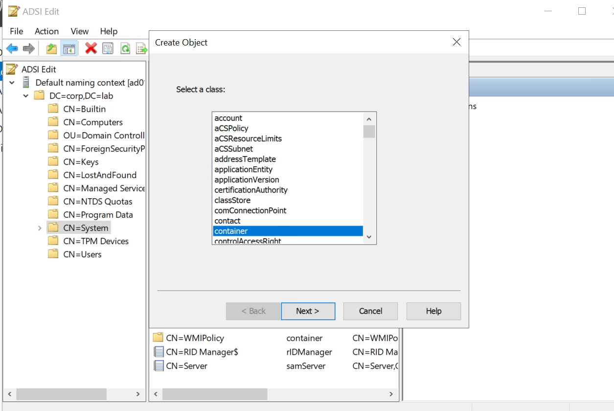
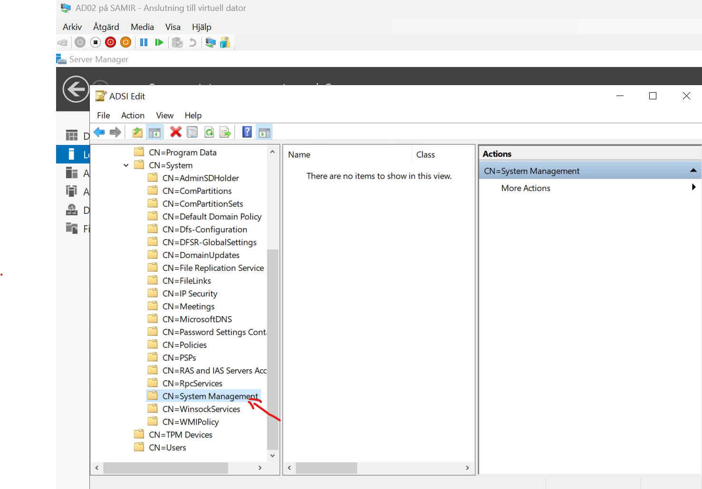
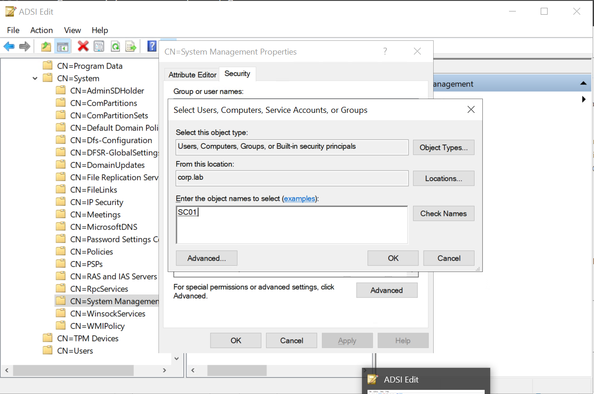
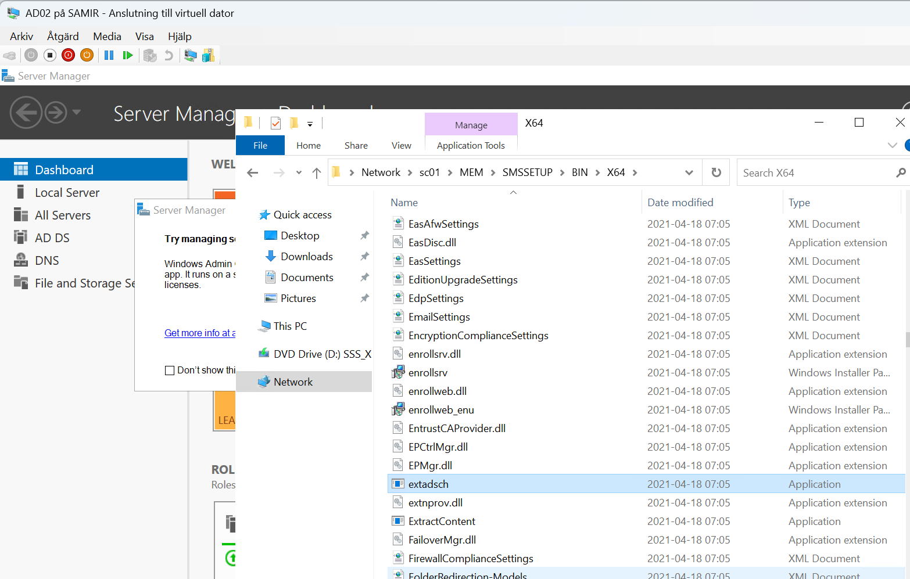
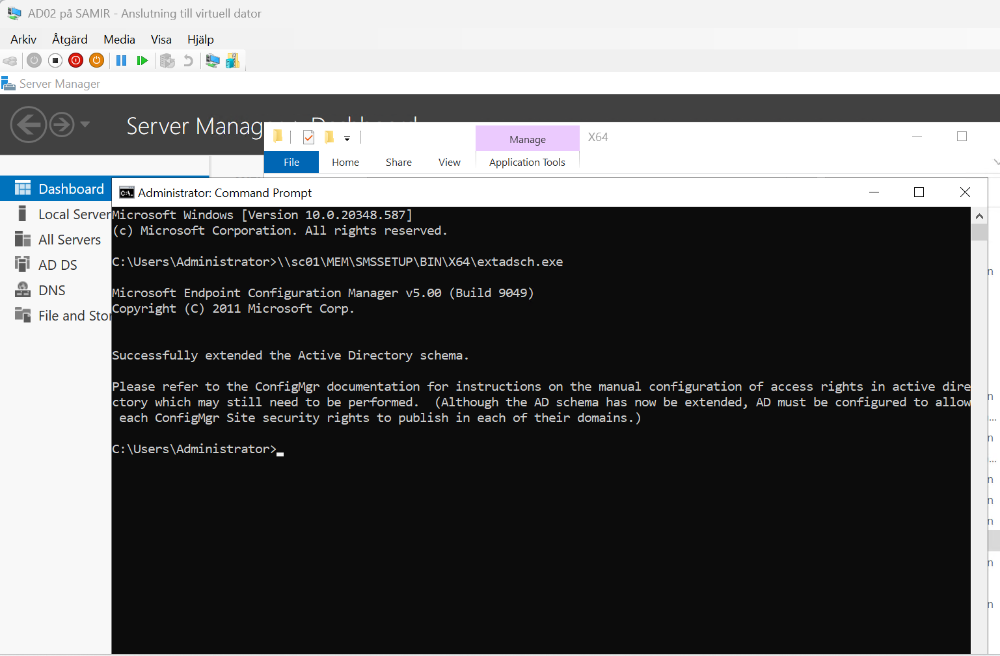

# 5. Extend the AD schema and create the System Management container

SCCM publishes site information to Active Directory so clients can find their site. This needs two one-time steps: a container with the right permissions, and a schema extension.

## Extract the SCCM installation media

On SC01, run `MEM_Configmgr_2103.exe` and unzip it to `E:\MEM`. Share the folder as `\\sc01\MEM` so AD01 can reach `extadsch.exe`.





## Create the System Management container

On AD01:

1. Open **ADSI Edit** and connect to the **Default naming context** (`LDAP://ad01.corp.lab/Default naming context`).

   

2. Go to `DC=corp,DC=lab` → `CN=System`.
3. Right-click **CN=System → New → Object → container**, with the name **`System Management`**.

   

   

## Give SC01 permission

1. In ADSI Edit (or **Active Directory Users and Computers** with **View → Advanced Features**), right-click **CN=System Management → Properties → Security**.
2. Click **Add → Object Types**, tick **Computers**, and enter **SC01**.

   

3. Give **SC01$** **Full Control**.
4. Set **Applies to: This object and all descendant objects**.

Step 4 matters: without it, SCCM can create the container's first objects but can't update them later.

## Extend the schema

The account must be in **Schema Admins**. The domain Administrator already is. If you just added yourself, log out and back in.

1. On AD01 (the schema master), find `extadsch.exe` on the shared media: `\\sc01\MEM\SMSSETUP\BIN\X64`.

   

2. Run it in an administrator command prompt:
   ```
   \\sc01\MEM\SMSSETUP\BIN\X64\extadsch.exe
   ```

   

3. Check `C:\ExtADSch.log`. The last line should say **Successfully extended the Active Directory schema**.

## After SCCM is installed

In the SCCM console, go to **Administration → Hierarchy Configuration → Active Directory Forests**, open `corp.lab`, go to the **Publishing** tab and tick site **GBG**.

---
Next: [6. Prerequisites and SCCM installation](06-sccm-install.md)
