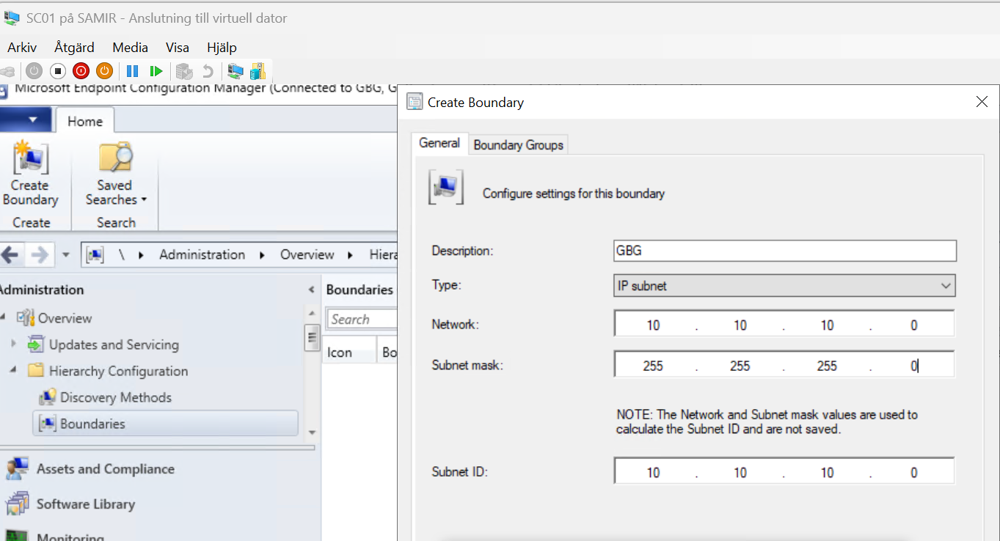
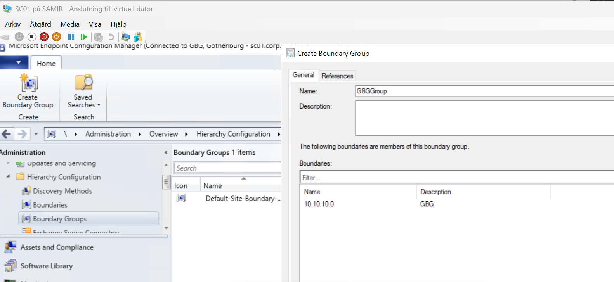
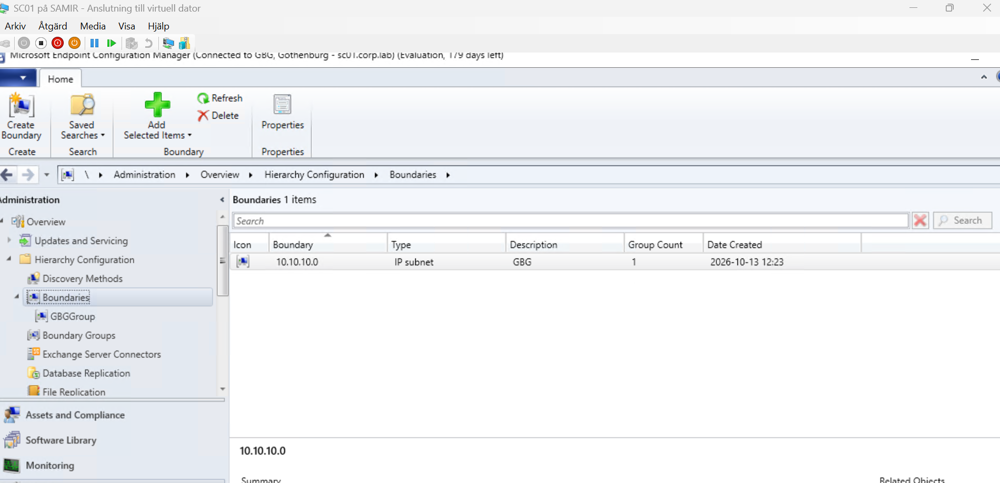
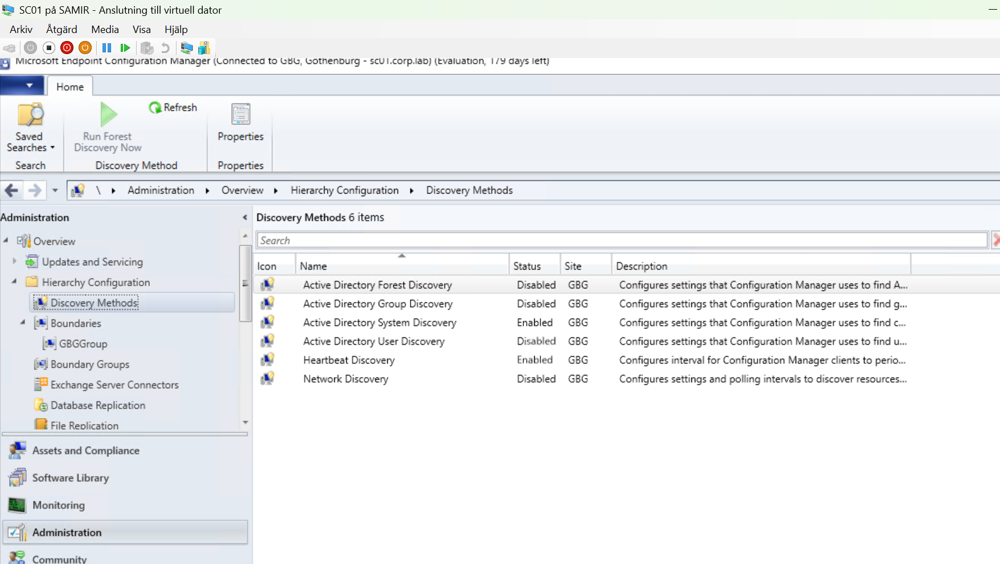
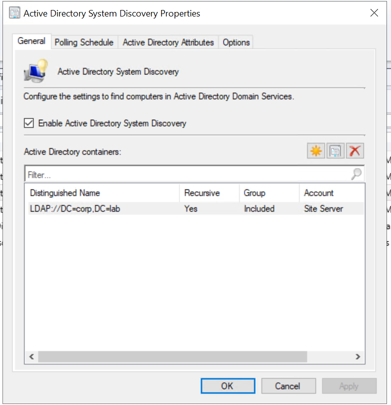
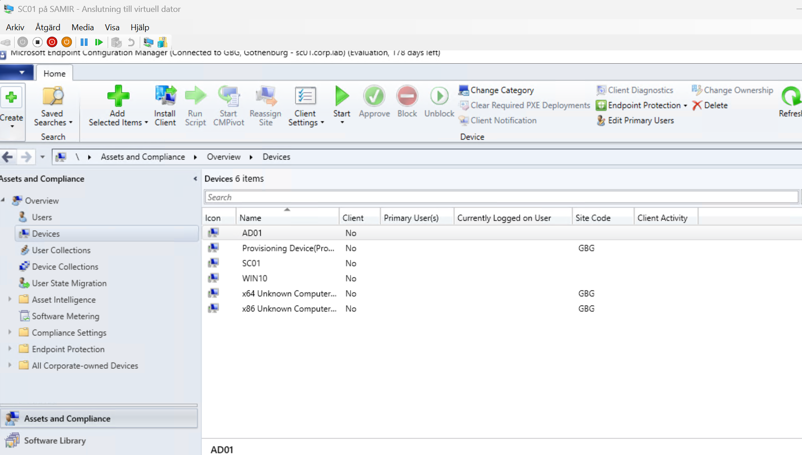

# 7. Boundaries, boundary groups and discovery

**Boundaries** describe where clients are on the network. **Boundary groups** decide which site a client joins and which server it downloads content from. **Discovery** finds the computers in Active Directory so SCCM knows about them.

## Create a boundary

**Administration → Hierarchy Configuration → Boundaries → Create Boundary**

| Field | Value |
|---|---|
| Description | GBG |
| Type | IP subnet |
| Network | 10.10.10.0 |
| Subnet mask | 255.255.255.0 |

Microsoft recommends **IP address range** over IP subnet. For this network that would be *Starting IP 10.10.10.1, Ending IP 10.10.10.254*, with no subnet mask. Use one type per network, not both.

## Create a boundary group

**Administration → Hierarchy Configuration → Boundary Groups → Create Boundary Group**

1. Name: **GBGGroup**. Click **Add** and select the boundary.

   

2. On the **References** tab:
   - ☑ **Use this boundary group for site assignment**, site **GBG**
   - **Site system servers → Add → SC01.corp.lab**

## Active Directory System Discovery

**Administration → Hierarchy Configuration → Discovery Methods → Active Directory System Discovery**

1. ☑ **Enable Active Directory System Discovery**.
2. Add a container: `LDAP://DC=corp,DC=lab`.
3. In the container dialog:
   - ☑ **Recursively search Active Directory child containers**
   - ☐ **Discover objects within Active Directory groups** (not needed, and it adds noise to the log)
   - **Sub containers to be excluded from discovery: empty**
4. Right-click the method and choose **Run Full Discovery Now**.

### Watch the log

Open `C:\Program Files\Microsoft Configuration Manager\Logs\adsysdis.log` with CMTrace (`...\Microsoft Configuration Manager\tools\cmtrace.exe`).

| Log line | Meaning |
|---|---|
| `Full synchronization requested` | A full run started |
| `Incremental synchronization requested` | Only changed objects are checked, so 0 objects can be normal |
| `DDR was written for system 'WIN10'` | The computer was discovered |
| `Discovered object is in excluded AD container. Skip.` | The object is in the container's exclusion list, which should stay empty |
| `found X objects` | Summary at the end of a run |

### Result

After a full discovery run, all machines appear under **Assets and Compliance → Devices**. **Client = No** is expected until the SCCM client is installed.

---
Next: [8. Client setup and client install](08-client.md)
