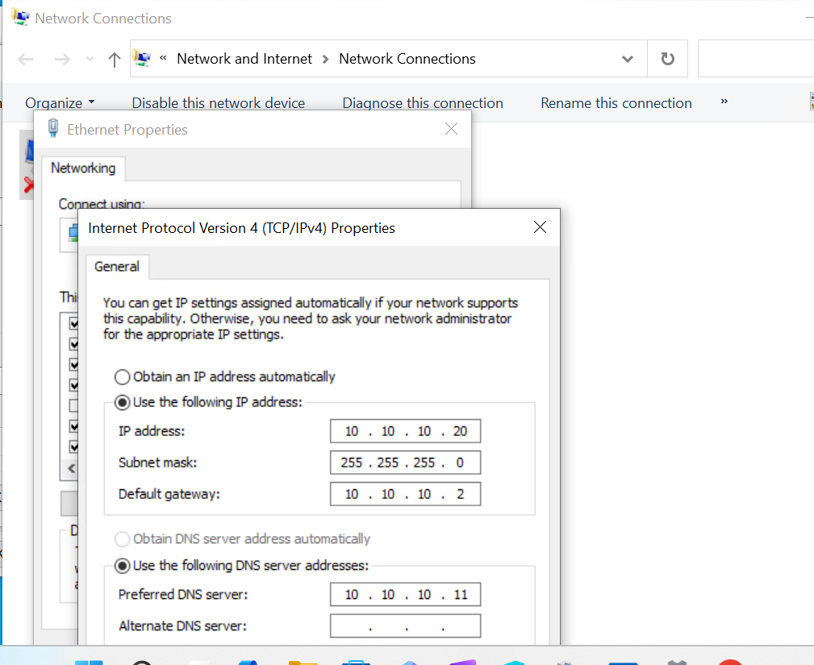
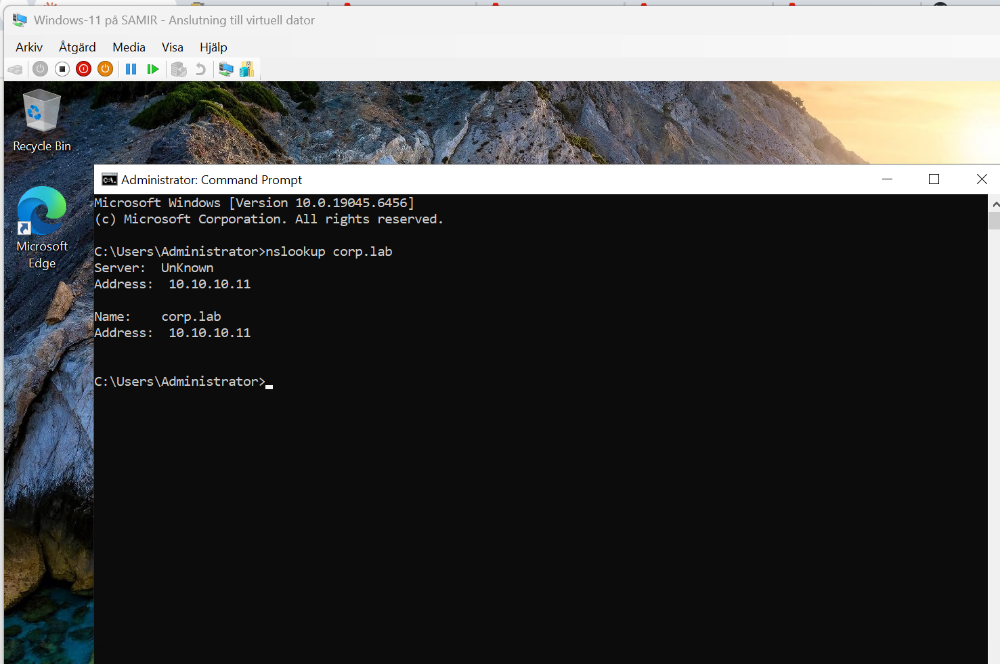
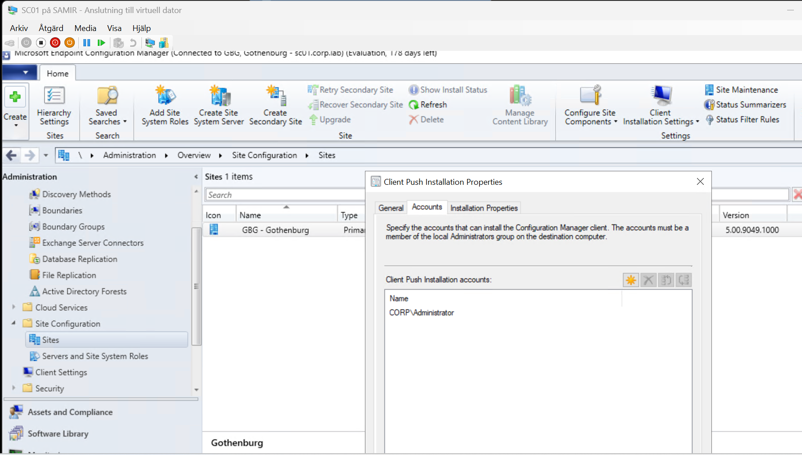
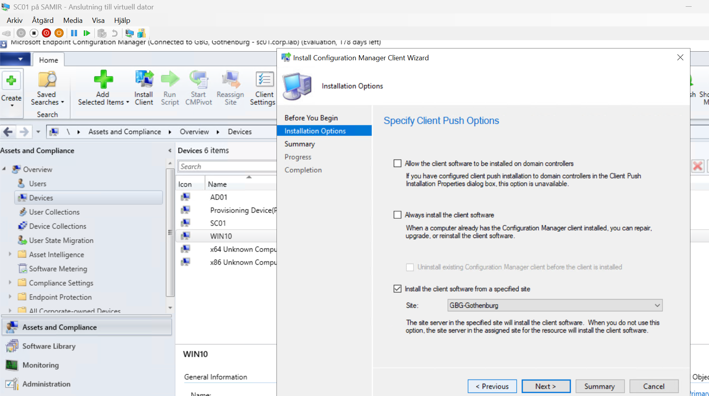
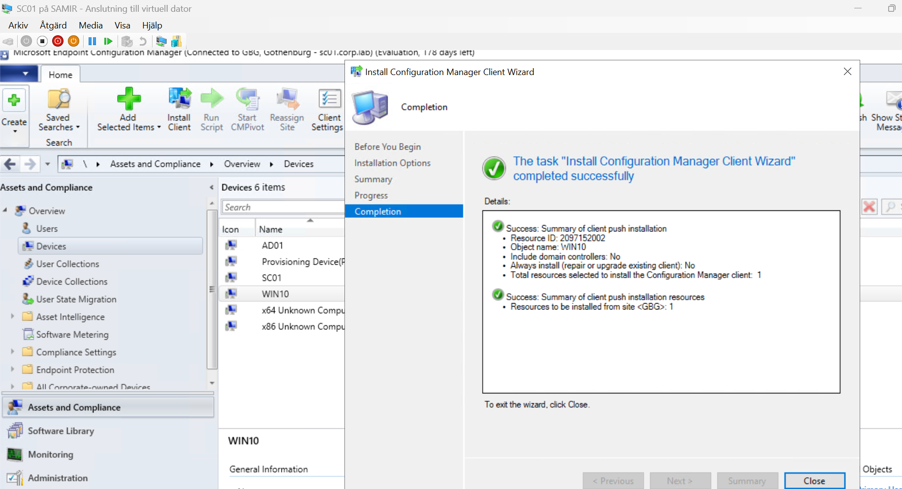
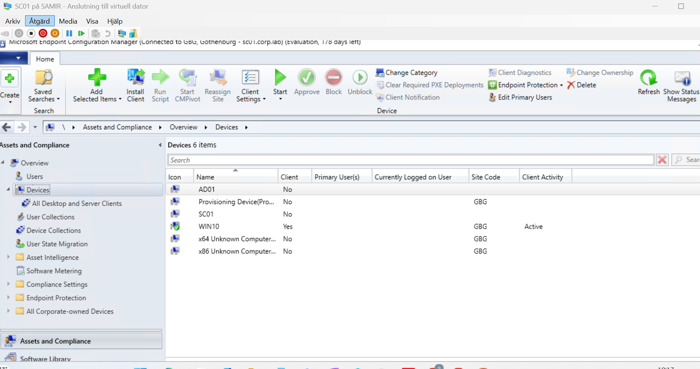
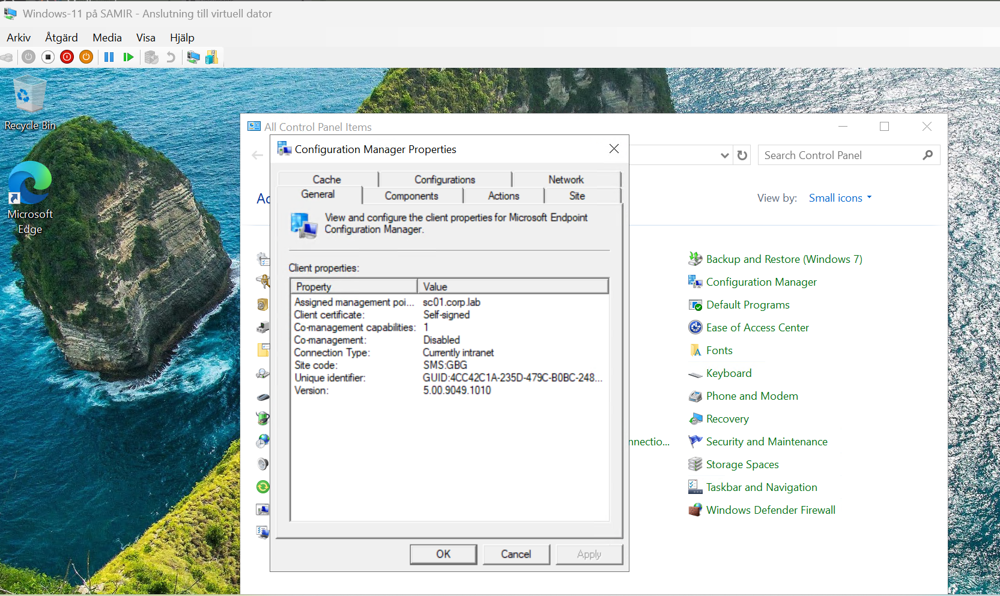

# 8. Client setup and client install (WIN10)

## Network settings

| Setting | Value |
|---|---|
| Hyper-V switch | LAN |
| IP address | 10.10.10.20 |
| Subnet mask | 255.255.255.0 |
| Default gateway | 10.10.10.2 |
| Preferred DNS | 10.10.10.11 |



## Join the domain

```
ping 10.10.10.11
nslookup corp.lab
```



```powershell
Add-Computer -DomainName corp.lab -Credential CORP\Administrator -Restart
```

## Install the SCCM client (Client Push)

### 1. Push account

**Administration → Site Configuration → Sites → GBG → Client Installation Settings → Client Push Installation → Accounts**: add an account that is local admin on the clients. I used `CORP\Administrator` in the lab. In production, use a dedicated service account.



### 2. Firewall on the client

Client push needs File and Printer Sharing and WMI. On WIN10 (admin PowerShell):

```powershell
Enable-NetFirewallRule -DisplayGroup "File and Printer Sharing"
Enable-NetFirewallRule -DisplayGroup "Windows Management Instrumentation (WMI)"
```

In a real environment, push these rules with a Group Policy instead.

### 3. Push the client

**Assets and Compliance → Devices → right-click WIN10 → Install Client**.

| Option | Setting |
|---|---|
| Allow the client software to be installed on domain controllers | Unticked |
| Always install the client software | Unticked (only needed to repair or reinstall an existing client) |
| Install the client software from a specified site | Ticked, **GBG-Gothenburg** |





### 4. Follow the install

| Where | Log | Success looks like |
|---|---|---|
| SC01 | `...\Microsoft Configuration Manager\Logs\ccm.log` | `Successfully completed request` for WIN10 |
| WIN10 | `C:\Windows\ccmsetup\Logs\ccmsetup.log` | `CcmSetup is exiting with return code 0` |

After 5–10 minutes, **Client** shows **Yes**, **Site Code GBG** and **Client Activity Active** in the console.



WIN10 now has **Configuration Manager** in the Control Panel and **Software Center** in the Start menu. The **General** tab confirms the client is assigned to management point `sc01.corp.lab`, site `SMS:GBG`, client version 5.00.9049.1010.



## Client actions

**Control Panel → Configuration Manager → Actions** forces the client to check in instead of waiting for its schedule:

- **Machine Policy Retrieval & Evaluation Cycle** – fetch new deployments
- **Application Deployment Evaluation Cycle** – evaluate and install apps

---
Next: [9. Application deployment](09-app-deployment.md)
